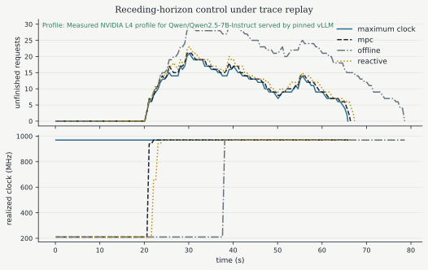

# Full simulation reproduction

Completed on 2026-11-05. Steps 3–5 have been executed and compared with the
imported reference. The baselines and related scheduling experiments reproduce
exactly. MPC reproduces latency, request timing, completion, and fallback
behavior, with a small energy/state difference traced to floating-point clock
quantization. The unchanged implementation does **not** achieve an exact match
for every MPC value.

## Protocol and integrity

- Ran `MPLBACKEND=Agg uv run --locked python scripts/build_inference_artifacts.py`
  with the full protocol: 50,000 transitions per FQI dataset, 50 sweeps, 200
  trees, and evaluation over 2,000 episodes of 300 steps.
- Used the included measured L4 profile and Azure request subsets. All imported
  simulation modules, reference data, and reference outputs retain their
  original import checksums. No GPU or cloud resources were used.
- Matched load dilation `3.5538284802900324`, the selected normalized trace
  window `[890, 950)` seconds, its 48 requests, and the 31-request burst shifted
  20 seconds earlier. The window times refer to the normalized workload.
- Matched the fixed 512-token chunked-prefill model, 0.1-second plant step,
  one-second control interval, ten-step MPC horizon, and 0.8-second deadline.
- Compared every field of all four metric CSVs and every leaf of the full JSON,
  including request records, applied clocks, and planned horizons. Numeric
  comparisons use relative tolerance `1e-6` and absolute tolerance `1e-8`;
  strings, booleans, schemas, and row identities must match.
- Environment: Python 3.12.14, macOS arm64, NumPy 2.3.1, SciPy 1.16.1,
  scikit-learn 1.9.1, and Matplotlib 3.10.3. Exact environment and artifact
  digests are recorded in [comparison.json](comparison.json).

## Frequency-controller comparison

| Controller | Reference energy (J) | Local energy (J) | Reference/local mean TTFT (s) | Reference/local p95 TTFT (s) |
|---|---:|---:|---:|---:|
| Maximum clock | 3505.989342 | 3505.989342 | 10.932136 | 18.406140 |
| Reactive governor | 3363.312931 | 3363.312931 | 12.511303 | 20.006140 |
| Offline schedule | 3646.818811 | 3646.818811 | 23.232136 | 31.276760 |
| MPC | 3341.784018 | 3341.179603 | 11.532136 | 19.006140 |

All request timing records match exactly, including those for MPC. All 48
requests complete during the drain. At the 60-second reporting horizon,
maximum-clock and MPC each leave nine requests unfinished, the governor leaves
11, and the offline schedule leaves 22. Energy includes the final drain.

Local MPC uses 4.7008% less modeled energy than maximum clock, with a
0.60-second increase in mean TTFT. All four controllers retain the reference's
100% TTFT violation rate and 12.5% TPOT violation rate. They also retain the
0.051837 W modeled power-limit overrun, with no modeled thermal or KV-capacity
violation. These are simulated tradeoffs, not evidence that a live latency
target has been met or that the thermal model is accepted for hardware control.

The open-loop nominal/shifted metrics, dynamic-programming metrics, and FQI
metrics all match exactly. Across all CSVs, **229 of 233 fields match**. The
four differences are confined to MPC:

| Metric | Reference | Local | Local minus reference |
|---|---:|---:|---:|
| Energy (J) | 3341.784018009 | 3341.179603165 | -0.604414844 |
| Energy/output token (J) | 3.814821938 | 3.814131967 | -0.000689971 |
| Peak modeled temperature (C) | 66.741630141 | 66.740395727 | -0.001234415 |
| Peak modeled KV tokens | 8417.327749332 | 8415.265525586 | -2.062223747 |

The JSON has 24,501 compared leaves: 24,203 are exactly equal and 298 differ
outside tolerance. Every difference is inside the MPC result; the clock
decision propagates into cumulative energy, temperature, power, and KV state.
The [complete CSV audit](metric_comparison.csv) and [JSON field summary](comparison.json)
retain these differences rather than treating them as a strict pass.

## MPC rounding investigation

The first changed applied action occurs at control time 21 seconds. SLSQP
returns `2039.9999999999975` MHz, only `2.5011104298755527e-12` MHz below
2040 MHz. The original quantizer uses an absolute `1e-12` MHz allowance when
rounding downward. That allowance is too small to include the upper level for
this candidate, so the applied request becomes 1125 MHz. The reference applies
2040 MHz at this control time. Its measured profile maps these requested
settings to realized clocks of 939.375 and 969.375 MHz, respectively.

Only one applied one-second decision changes. Two planned horizons differ,
including future actions that are never applied. The source optimizer and
quantizer are unchanged; the original run's raw solver candidates are not
available, so its precise floating-point history cannot be reconstructed.

Two follow-up checks establish the effect:

1. An instrumented repeat records raw solver candidates without changing the
   optimization. It reproduces the local full-run metrics and request records
   exactly: 67 accepted solves, zero fallback, and a maximum measured solve
   time of 0.048715 seconds, below the 0.8-second deadline.
2. Replaying the reference's applied clock decisions through the same local
   plant restores **all reference MPC metrics and request timing records
   exactly**. This isolates the observed discrepancy to the clock decisions.

See [mpc_solves.csv](mpc_solves.csv) and
[mpc_diagnostic_summary.json](mpc_diagnostic_summary.json). The imported
controller tests also exercise forced-deadline fallback. Raw diagnostic
trajectories remain in ignored `runs/inference_serving/mpc_diagnostic.json`.

A hardware-ready controller needs a deliberate, tested policy for floating-point
values near supported clock boundaries. That follow-up remains part of hardware
preparation; this reproduction preserves the original implementation.

## Outputs and reproduction commands

```bash
MPLBACKEND=Agg uv run --locked python scripts/build_inference_artifacts.py
uv run --locked python scripts/compare_inference_results.py
MPLBACKEND=Agg uv run --locked python scripts/diagnose_mpc.py
MPLBACKEND=Agg uv run --locked pytest -q --disable-warnings
```

The comparator intentionally exits with status 1 when differences remain. On
this run it reports the four MPC metric differences and the 298 JSON values;
it rejects quick-protocol artifacts. The diagnostic command writes raw solves
and both replay trajectories under `runs/`. The compact diagnostic summary and
solve CSV here preserve evidence from the investigation.

Validation: **66 tests passed**, including seven new comparison-audit cases.
The test run also emitted 204 dependency deprecation warnings from Matplotlib
and pyparsing. No imported simulator or controller code was changed.

Full generated JSON, CSVs, and five SVG figures remain under
`runs/inference_serving/`. The compact audit and this copied MPC figure are
tracked here; reference artifacts remain unchanged.



The next project stage is preparing fixed-clock measurements on the existing
Google Cloud L4 VM.
